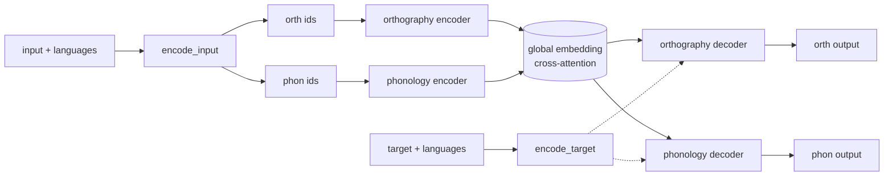

# BRIDGE

[](https://github.com/emelex-ai/BRIDGE/actions/workflows/ci.yml)
[](https://www.python.org/)
[](https://github.com/astral-sh/ruff)
[](#license)

A multilingual neural model of printed-word naming. **BRIDGE** maps orthographic and phonological representations of arbitrary length into a unified embedding via cross-attention, then decodes back into either modality. Multilingual lexicons (English, Spanish) and per-word language tagging are supported out of the box, enabling code-switching studies.

> [!NOTE]
> This repository ships the **core model and tokenizers** as an importable library. It does **not** contain experiment scripts, training configs, datasets, loggers, or cloud integrations, those live in downstream research repos that depend on `bridge`.

`docs/architecture.md` is the map of the system. Read it before changing anything structural.

---

## Quick start

```bash
git clone https://github.com/emelex-ai/BRIDGE.git
cd BRIDGE
uv sync
uv run python -c "from bridge import Model, BridgeTokenizer; print(BridgeTokenizer().encode_input(['cat'], ['EN']))"
```

If `uv` is not installed: `curl -LsSf https://astral.sh/uv/install.sh | sh`.

Dependencies are torch, pydantic, pandas and numpy. Nothing else is installed.

---

## What's in here

```text
bridge/
├── core/                         # phonreps.csv + pronunciation_lexicons/{en,es}.json
├── domain/
│   ├── datamodels/               # configs (ModelConfig, DatasetConfig, TrainingConfig, …) and the
│   │                             # types of an example: BridgeInput, BridgeTarget, BridgeBatch
│   ├── tokenizer/                # BridgeTokenizer, PhonemeTokenizer, CharacterTokenizer
│   ├── data/                     # BridgeDataset: rows of input and target
│   └── model/                    # Encoder, Decoder, Model
├── application/training/         # TrainingPipeline, ortho_metrics, phon_metrics
└── utils/                        # device_manager, get_project_root, set_seed
docs/decisions/                   # numbered, immutable architecture decision records
tests/                            # unit tests, the golden-master fixture, and bench_phon.py
```

---

## Public API

`bridge.__all__` is the supported surface. Everything under `bridge.application` and `bridge.domain` is internal layout a reorganisation is free to move, and [`tests/test_public_api.py`](tests/test_public_api.py) asserts that the exported names are enough to assemble and run a pipeline.

```python
from bridge import (
    Model, ModelConfig, PATHWAYS, Pathway,
    BridgeDataset, DatasetConfig,
    BridgeTokenizer, CharacterTokenizer, PhonemeTokenizer,
    TrainingPipeline, TrainingConfig, TrainingEvent, TrainingPhase,
    BridgeBatch, BridgeInput, BridgeTarget, Tokens, Target, GenerationOutput,
    PhonemeTable, load_phoneme_table,
    VocabSpec,
)
```

> [!NOTE]
> `Model` and `BridgeTokenizer` are **sibling objects**: neither holds a reference to the other. The model needs vocab sizes and special-token IDs (to size embeddings and to know when to stop generating); these flow through `ModelConfig.vocab` (a `VocabSpec`). Use `VocabSpec.from_tokenizer(tokenizer)` to derive one in a single line.

---

## Architecture



The encoders read the input. The dotted lines are training only: there the decoders are fed the target and scored against it. Generation has no target.

Five pathways, listed in `bridge.PATHWAYS` and tabulated in [`docs/architecture.md`](docs/architecture.md): `o2p`, `p2o`, `o2o`, `p2p` and `op2op`. Any of them can train (`TrainingConfig.training_pathway`) or generate (`Model.generate(inputs, pathway, max_new_tokens=...)`).

### Position and length

Position is a rotation inside the self-attention of the two encoders and the two decoders (rotary position embedding). Attention sees how far apart two tokens are, not which slots they fill. No table is indexed by position, so the model has no maximum length: a sequence of any length trains, evaluates and generates.

Two things to know before using long sequences. Both were measured, and [decision 0017](docs/decisions/0017-positions-are-computed-for-any-length.md) has the numbers.

- **Train on the lengths you will use.** A model reads an input somewhat longer than any it trained on. It does not repeat a phrase longer than any it trained on.
- **Set `d_embedding` for phrases.** It is the number of rows of the global embedding, which is all a decoder reads of the input. With the default of 2, a model trained on phrases of up to 47 tokens repeats 0.817 of those of 9 to 19 tokens exactly, 0.223 of those of 23 to 30, and none of 33 to 47. With 8 rows it repeats 0.620 of the longest group, and with 32 rows 0.895.

### Model sizes

`ModelConfig` takes the sizes below and a `vocab`. Each size is at least one, and `nhead` must divide `d_model` into heads of two or more dimensions. A size that breaks a rule raises when the config is built.

| size | default |
|---|---|
| `d_model` | 64 |
| `nhead` | 2 |
| `d_embedding` | 2 |
| `num_orth_enc_layers` | 2 |
| `num_phon_enc_layers` | 2 |
| `num_mixing_enc_layers` | 2 |
| `num_orth_dec_layers` | 2 |
| `num_phon_dec_layers` | 2 |

A checkpoint loads only into a model with the same tensors, name for name and shape for shape. Anything else raises a `RuntimeError` that names the file, and leaves the model as it was. That includes a checkpoint from a model that held position tables, such as one saved at commit `a3cb285`. There is no migration for those.

---

## Input and target

A training example is two things: an **input**, which the model reads, and a **target**, which it is taught to write. They may be equal. Repetition, reading a word and writing it back, is a dataset whose two columns match.

Each side has its own types, so one cannot be passed for the other. In them `orth` is orthography and `phon` is phonology.

| type | holds | read by |
|---|---|---|
| `Tokens` | `ids`, `pad_mask` | an encoder |
| `Target` | `ids`, `pad_mask`, `labels` | a decoder, which is fed `ids` and scored against `labels` |
| `BridgeInput` | `orth` and `phon`, each a `Tokens` or `None` | the encoders |
| `BridgeTarget` | `orth` and `phon`, each a `Target` | the decoders and the loss |
| `BridgeBatch` | `input` and `target` | `TrainingPipeline.forward` |

```python
from bridge import BridgeBatch, BridgeTokenizer

tok = BridgeTokenizer()

# Read English, write Spanish. Each side is encoded by its own call.
inputs = tok.encode_input(["the cat"], ["EN"])
target = tok.encode_target(["gato"], ["ES"])
batch = BridgeBatch(input=inputs, target=target)

# The two sides need not be the same length.
tuple(batch.input.orth.ids.shape), tuple(batch.target.orth.ids.shape)
# ((1, 10), (1, 6))

# A target's labels are its ids one position on: the decoder is fed
# [ES, BOS, g, a, t, o] and scored against [BOS, g, a, t, o, EOS].
tok.decode(batch.target.orth.labels.tolist())["orthographic"]
# ['gato']

# A nonword has no pronunciation, so its input carries orthography alone.
tok.encode_input(["blorfq"], ["EN"]).phon is None
# True
```

Three mistakes fail where they are made:

- An input passed where a target belongs raises `TypeError`. `BridgeBatch(input=inputs, target=inputs)` does, and so does `Model.generate` handed a target.
- A pathway that reads a modality the input lacks raises `ValueError` naming both: `pathway 'p2o' reads phon, which this input does not carry`.
- A target is scored in both modalities, so `encode_target` returns `None` when a word has no pronunciation.

### Generating

`Model.generate` reads a `BridgeInput` and nothing else. Every call needs `max_new_tokens`, the most tokens to write, and a call without it raises `TypeError`. A pathway that writes orthography also needs `orth_start`, which names the language its output starts in. Omitting that raises `ValueError`.

```python
from bridge import BridgeTokenizer, Model, ModelConfig, VocabSpec

tok = BridgeTokenizer()
model = Model(ModelConfig(d_model=64, nhead=2, vocab=VocabSpec.from_tokenizer(tok)))
inputs = tok.encode_input(["cat", "the word is gato"], ["EN", "EN EN EN ES"])

# o2p writes phonology, so the input is all it needs.
spoken = model.generate(inputs, "o2p", max_new_tokens=30, deterministic=True)

# o2o writes orthography. orth_start takes one code per row: here the first row is
# written starting in Spanish and the second starting in English.
start = tok.orth_start(["ES", "EN"])
written = model.generate(inputs, "o2o", max_new_tokens=30, orth_start=start, deterministic=True)

# The output opens with the [LANG, BOS] rows the caller named. ES is id 8, EN is id 7.
written.orth_tokens[:, :2].tolist()
# [[8, 0], [7, 0]]

# max_new_tokens counts what is written after that start, so a row is at most 2 + 30 wide.
written.orth_tokens.shape[1] <= 2 + 30
# True

# A row that reached the cap holds no [EOS]. A row that finished holds one.
finished = (written.orth_tokens == model.model_config.vocab.orth_eos_id).any(dim=1)
```

`orth_start` names the language of the first word only. A later change of language is the decoder's to emit, as a language token in its output.

#### Choosing `max_new_tokens`

`max_new_tokens` is keyword-only and required. It has no default, because the model holds no maximum length to fall back on. It must be a positive `int`.

It counts the tokens written after the start of each sequence. The start is `[LANG, BOS]` for orthography and `[BOS]` for phonology. A sequence stops at `[EOS]` or at the cap, whichever comes first. On `op2op` the one cap applies to each modality written.

| what is written | tokens it takes |
|---|---|
| orthography of `n` characters, spaces included | `n + 1`, the last being `[EOS]`, plus one for each change of language |
| phonology | one for each phoneme, one for each gap between words, and one for `[EOS]` |

So `"the word is gato"`, 16 characters with one change of language, takes 18. Set the cap to the longest output you expect, with a little room.

- **Too low cuts the output.** A cut row ends without `[EOS]`. Test the ids for it, as above. The decoded text cannot tell you: a cut row can decode to the same string as a finished shorter one.
- **Too high costs time, not correctness.** A finished row writes padding from its `[EOS]` on, and the loop stops once every row has finished. One row that never finishes runs the whole batch to the cap, and each step decodes everything written so far. An untrained model can write to the cap on every row.
- **Phonology finishes on a feature.** A phonological position is a set of features. A row is finished when the `[EOS]` feature is on at one of its positions, alone or beside others.

---

## Two phoneme id spaces

The single easiest way to get silently wrong output. Both are `torch.long` and only naming separates them.

| space | range | indexes | where it appears |
|---|---|---|---|
| **row** | 0–90 | *which phoneme*, a row of the feature table | the phonological `ids` of an input and of a target, `Model.embed_phon_tokens` |
| **feature** | 0–35 | *which phonetic feature*, a column | `GenerationOutput.phon_tokens`, `PhonemeTokenizer.decode`, `VocabSpec.phon_*_id`, the phonological `labels` of a target |

```python
from bridge import load_phoneme_table

table = load_phoneme_table()

# Phoneme to row id.
row = table.row_of("AE1")
row
# 20

# Row id to its active feature columns.
table.features_of(row).tolist()
# [14, 15, 17, 22, 29]
```

---

## Multilingual support

The phoneme tokenizer loads per-language lexicons from `bridge/core/pronunciation_lexicons/` at construction. English (`EN`) and Spanish (`ES`) are the supported languages. The optional `custom_cmudict_path` argument adds or replaces pronunciations in either, using the same nested-by-language JSON shape.

Every word carries its own language. `languages` is a list with one entry per row. An entry is one code for the whole row, or one code per word.

```python
from bridge import BridgeTokenizer

tok = BridgeTokenizer()                                   # loads en + es by default

# One entry per row: "hola" is Spanish, "world" is English.
words = tok.encode_input(["hola", "world"], ["ES", "EN"])

# One code per word, for a row that changes language.
mixed = tok.encode_input(["the word is gato"], ["EN EN EN ES"])
tok.decode_with_languages(mixed.orth.ids.tolist())
# [('the word is gato', ['EN', 'EN', 'EN', 'ES'])]
```

Phonology looks each word up in its own language's lexicon, by its position in the row. A word missing from that lexicon has no pronunciation, whichever other lexicon holds it. `encode_input` then returns an input whose `phon` is `None`, and `encode_target` returns `None`.

Orthography opens a row with its first word's language token (`"--"`, `"EN"`, or `"ES"`) and `[BOS]`. A language token appears again only where the language changes, directly before that word's first character:

```text
the word is gato        EN EN EN ES
[EN] [BOS] t h e _ w o r d _ i s _ [ES] g a t o [EOS]
```

An input in one language is therefore laid out as `[LANG, BOS, …chars, EOS, PAD, …]`. A call with no `languages` leaves every row unspecified: the `"--"` token, and English pronunciations.

### Dataset files

A `BridgeDataset` file holds four columns: the input, its languages, the target, and its languages. A language cell is one code for the whole string, or one code per word, separated by spaces.

```csv
word_raw,language,target_raw,target_language
cat,EN,cat,EN
gato,ES,gato,ES
the word is gato,EN EN EN ES,the word is gato,EN EN EN ES
the cat,EN,el gato,ES
```

The first three rows are repetition: the target is the input. The last row reads English and is taught to write Spanish.

| column | holds | when the column is missing |
|---|---|---|
| `word_raw` | the input | the load raises |
| `language` | the input's languages | every word is English |
| `target_raw` | the target | the load raises, and the message names the fix: for repetition, copy `word_raw` |
| `target_language` | the target's languages | a row whose `language` is one code gives its target that code; a row whose `language` is per word raises, naming the row |

The pkl format is columnar, `{"word_raw": [...], "language": [...], "target_raw": [...], "target_language": [...]}`, and a language cell may also be a list or tuple of codes.

A bad language cell, on either side, raises when the file loads, naming the row: a blank cell, `--`, an unsupported code, or a code count that is neither one nor the string's word count. A blank `word_raw` or `target_raw` cell raises too. A comma between codes stops the load of a csv on disk too. Pronunciations are not checked at load. A word with no pronunciation in its language, in the input or in the target, raises when its row is read.

`dataset[i]` takes an `int` or a `slice` and returns a `BridgeBatch`.

Orthographic accuracy comes as two pairs. `letter_wise_accuracy` and `word_wise_accuracy` count every scored token, language switches included. The `_without_switches` pair leaves the switches out and measures spelling alone. See [decision 0015](docs/decisions/0015-language-belongs-to-each-word.md).

---

## Usage example

This trains `o2p` on the four-row file shown under [Dataset files](#dataset-files), saved as `my_pairs.csv`, and then generates.

```python
import torch

from bridge import (
    BridgeDataset, DatasetConfig,
    BridgeTokenizer,
    Model, ModelConfig,
    TrainingPipeline, TrainingConfig,
    VocabSpec,
)

# Tokenizer and dataset come first. Share one tokenizer across datasets: building a
# second re-parses the pronunciation lexicons.
tokenizer = BridgeTokenizer()
dataset = BridgeDataset(DatasetConfig(dataset_filepath="my_pairs.csv"), tokenizer=tokenizer)

# The model is built from config alone; vocab info flows through ModelConfig.vocab.
model = Model(ModelConfig(d_model=64, nhead=2, vocab=VocabSpec.from_tokenizer(tokenizer)))

# Placement is yours. The pipeline follows the model, it does not move it.
model.to("cuda" if torch.cuda.is_available() else "cpu")

pipeline = TrainingPipeline(
    model=model,
    training_config=TrainingConfig(training_pathway="o2p"),
)

# The library owns the step; you own the loop. Which slices, how many epochs, when to
# shuffle, what to log and when to checkpoint are all yours. See docs/decisions/0013.
cutpoint = int(len(dataset) * 0.8)
train_slices = [slice(i, min(i + 32, cutpoint)) for i in range(0, cutpoint, 32)]
val_slices = [slice(i, min(i + 32, len(dataset))) for i in range(cutpoint, len(dataset), 32)]

for epoch in range(pipeline.start_epoch, 3):
    dataset.shuffle(cutpoint, seed=epoch)
    for event in pipeline.train_steps(dataset, train_slices, epoch):
        print(event.epoch, event.step, float(event.metrics["loss"]))

    # `evaluate` is the no-grad counterpart of `single_step`. Scoring is opt-in on the
    # training path because the metrics cost ~7 ms and ~12 extra device syncs per step.
    scores = [pipeline.evaluate(dataset, s) for s in val_slices]
    pipeline.save_checkpoint(f"epoch_{epoch}.pth", epoch, dataset=dataset)

# Generation reads an input and nothing else. The tokenizer builds on the process device,
# so the input is moved to wherever the model is.
inputs = tokenizer.encode_input(["cat", "gato"], ["EN", "ES"]).to(model.device)
output = model.generate(inputs, "o2p", max_new_tokens=30, deterministic=True)
```

Each event's `metrics` also carry `input` and `target`, the strings of the rows the step covered.

> [!IMPORTANT]
> The library provides no `Trainer`, no YAML launcher, no metrics logger and no cloud client. Downstream research repos compose these primitives into their own training scripts and decide for themselves what to record and where.

---

## Phonological representations

Phonemes are encoded against the feature table at [`bridge/core/phonreps.csv`](bridge/core/phonreps.csv) (31 distinctive features) augmented with 5 special tokens (`[BOS]`, `[EOS]`, `[UNK]`, `[SPC]`, `[PAD]`). A phoneme's embedding is the mean of its active feature embeddings, never a free parameter of its own, so phonemes sharing features share embedding mass. Pronunciations are looked up from the bundled lexicons. A word no lexicon holds has no phonology: its input carries `phon=None`, and it cannot be a target.

The feature inventory is based on the phonological vectors from [Traindata](https://github.com/MCooperBorkenhagen/Traindata).

---

## Development

```bash
uv sync --group dev                      # install dev deps (ruff, mypy, pytest)
uv run pytest -q                         # tests
uv run ruff check bridge tests           # lint
uv run ruff format bridge tests          # format
uv run mypy                              # type-check
```

CI runs `lint`, `typecheck` and `test` on every push and PR. See [`.github/workflows/ci.yml`](.github/workflows/ci.yml).

[`tests/test_documentation.py`](tests/test_documentation.py) asserts the checkable claims in this file and in `docs/architecture.md` against the running system, so a structural change that outdates either one fails the suite rather than going unnoticed.

> GPU verification: BRIDGE is tested against PyTorch 2.12 + CUDA 13 (Blackwell / sm_120 supported). Run `python -c "import torch; print(torch.cuda.is_available())"` after `uv sync` to confirm.

---

## License

MIT. See project metadata in [`pyproject.toml`](pyproject.toml).
